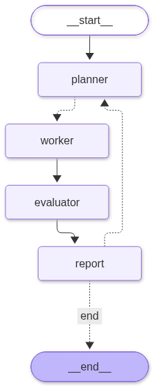

# AutoML Crew

A multi-agent system that improves a machine learning model on its own. A planner proposes experiments, worker agents implement them in parallel, and the best result becomes the starting point of the next round.

Built with **LangGraph** and **LangChain**. All generated code runs in an isolated **Docker** sandbox.

> Work in progress.

## How it works



- **Planner** (LLM): reads the dataset description, the current best solution and past results, and proposes a few ideas, each one a single change.
- **Workers** (LLM subagents, run in parallel with `Send`): each one applies its idea to the best solution, gets it scored, and fixes its code if it fails.
- **Evaluator** (plain code): promotes the round's best result if it beats the current best.
- **Stopping rule** (plain code): loops until the round budget is spent or the score stops improving.

## Design principles

- **LLMs propose, code judges.** Agents only write a `fit_predict(X_train, y_train, X_valid)` function. A trusted harness scores it on cross-validation folds and checks the predictions.
- **Reproducible folds.** Folds are created once with a fixed seed and tied to a SHA-256 fingerprint of the dataset, so every experiment is scored on the same splits.
- **Sandboxed execution.** No network, read-only filesystem, CPU, memory and time limits, non-root user.

## First results

Titanic dataset, ROC AUC with 5-fold cross-validation, using `gemini-3.5-flash-lite`:

| | ROC AUC |
|---|---|
| Baseline (logistic regression) | 0.852 ± 0.022 |
| After 3 rounds (9 experiments) | 0.883 ± 0.021 |

## Quickstart

Requires Python 3.12+, [uv](https://docs.astral.sh/uv/), Docker and an LLM API key.

```bash
uv sync
docker build -t automl-sandbox .
cp .env.example .env      # add your API key and model, e.g. google_genai:gemini-3.5-flash-lite

uv run python -m harness.folds --train data/titanic.csv --target Survived --task classification
uv run run_lab.py
```

## Project structure

```
src/harness/   trusted part: folds, scoring, Docker sandbox
src/agents/    LLM part: planner, worker subagent, graph
solutions/     hand-written baseline the agents have to beat
run_lab.py     entry point
```